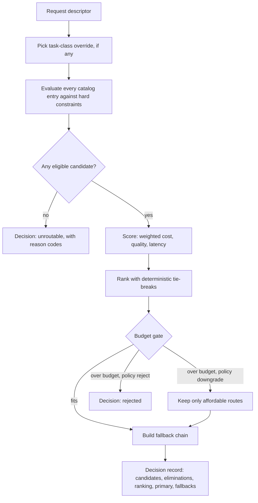
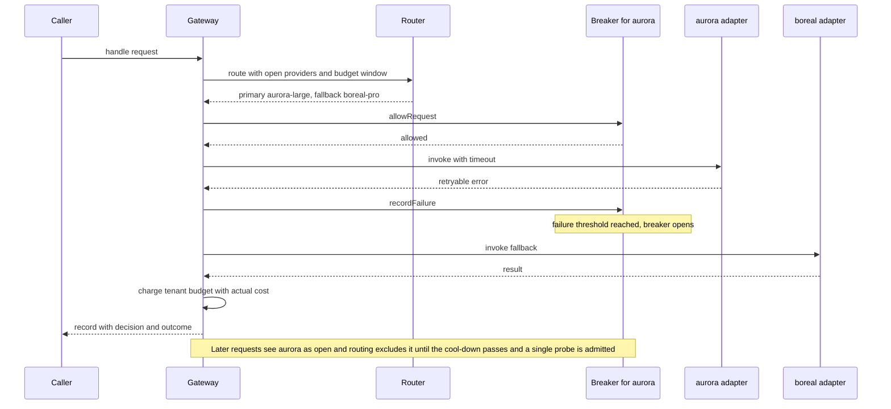
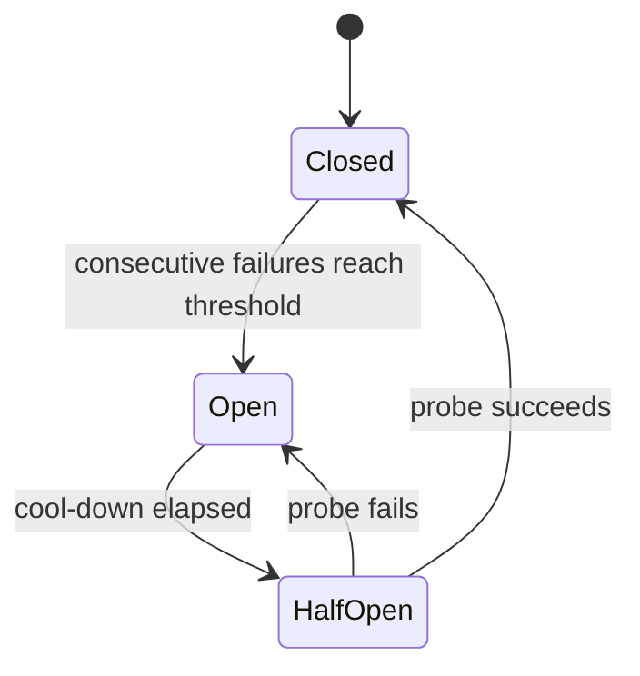

# llm-routing-gateway

A policy-driven model router with **explainable decisions**, **fallbacks with circuit breakers**, **tenant budgets**, and a **replay harness** that regression-tests routing changes against recorded traffic before they ship.

> This is an independent reference implementation, written from scratch for demonstration; not extracted from any production system. Built with AI coding assistance (Claude Code).
>
> All providers (`aurora`, `boreal`, `cirrus`), models, regions, tenants and **prices are fictional**. Prices are made up and exist only so that cost-based ranking has numbers to work with. No network calls are made anywhere; provider adapters are in-process mocks behind an interface that a real SDK could implement. The repository has zero runtime dependencies.

## The problem

In most applications the choice of model is a string literal buried in a call site. That is fine until it is not: a provider has an outage, a tenant's contract forbids a vendor, a cheaper model becomes good enough for classification, a data-residency rule appears, or finance asks why spend doubled last month. Each of those is an *operational policy* question, and answering them by editing code scattered across a codebase is slow, unreviewable, and impossible to test as a whole.

This project treats model choice as a **policy evaluated against a catalog**, the way a firewall evaluates rules or a scheduler evaluates constraints:

- the **catalog** says what exists (capabilities, context limits, regions, fictional prices, latency class, quality tier);
- the **request descriptor** says what a call needs (capabilities, token estimates, cost ceiling, latency, region, tenant, task class);
- the **policy** says how to choose (hard constraints, deny rules, weights, per-task overrides, budgets, breaker tuning);
- the **decision record** says exactly what happened and why, in machine-readable form;
- the **replay harness** says what *would* change if you edited the policy, using real recorded requests, before anything is deployed.

## Features

- **Model catalog as data** with validation: provider, model id, capabilities (tools, vision, JSON output, max context), per-million-token input/output prices, latency class, region tags, quality tier.
- **Request descriptor**: required capabilities, estimated input/output tokens, max cost, slowest acceptable latency class, required region, tenant id, task class.
- **Routing policy as JSON**: hard-constraint filtering, then ranking by weighted cost/quality/latency; per-task-class overrides (weights, quality floor, provider allow-list, fallback depth); explicit deny rules; deterministic tie-breaking.
- **Validation on load** with hand-written validators (no schema library). Every problem is reported with a JSON path; unknown keys are rejected; policy references to unknown providers or models are caught against the catalog.
- **Explainable decisions**: every catalog entry is listed, every elimination carries one or more reason codes, the full ranking with score components is recorded, along with the chosen route and the ordered fallback chain. Same inputs, byte-identical decision.
- **Execution with fallback**: try the primary; on a retryable error or timeout move down the chain; a non-retryable error stops the walk.
- **Per-provider circuit breaker** (closed / open / half-open) with an injectable clock. Open providers are excluded from routing and the exclusion is recorded in the decision.
- **Tenant budgets** per fixed time window; an over-budget request is rejected or downgraded to the best affordable route, with the reason recorded.
- **Decision log**: append-only JSONL of request, decision and outcome.
- **Replay harness**: re-route a recorded log against a candidate policy and/or catalog **without executing anything**, and get a diff (changed primaries, newly unroutable requests, estimated cost delta, per-task-class summary). Thresholds turn it into a CI gate via the exit code.
- **CLI**: `route` and `replay`, via `tsx` during development or as built bins.

## Architecture

### Routing pipeline

`routeRequest` is a pure function: no clock, no randomness, no I/O. Everything environmental (open breakers, the tenant's budget window) is passed in as `context` and echoed into the decision so the record is self-contained and replayable.



Hard constraints are all evaluated (not short-circuited), so an eliminated model lists *every* reason it failed:

| Code | Meaning |
| --- | --- |
| `DENY_RULE` | a policy deny rule matched (provider, model, tenant and/or task class) |
| `PROVIDER_NOT_ALLOWED` | the task class restricts providers and this one is not listed |
| `MISSING_CAPABILITY` | lacks a required capability (one entry per missing capability) |
| `CONTEXT_EXCEEDED` | input + output tokens exceed the model's context window |
| `REGION_MISMATCH` | model is not offered in the required region |
| `LATENCY_EXCEEDS_LIMIT` | latency class is slower than the request allows |
| `QUALITY_BELOW_MINIMUM` | quality tier is under the task class floor |
| `COST_EXCEEDS_LIMIT` | estimated cost is above the request's cost ceiling |
| `CIRCUIT_OPEN` | the provider's circuit breaker is open |

Ranking: each surviving candidate gets a cost score (min-max normalised within the eligible set, cheapest = 1), a quality score (`(tier - 1) / 4`) and a latency score (`fast` 1, `standard` 0.5, `slow` 0). The final score is the weight-normalised sum, rounded to six decimals. Ties break on lower estimated cost, then higher quality tier, then route id (`provider/model`) in plain string order.

### Fallback and circuit breaker





Only *availability* failures (retryable errors and timeouts) count against a breaker. A non-retryable error means the provider answered and the request was at fault, so it stops the walk and is treated as proof of liveness.

### Modules

| Module | Responsibility |
| --- | --- |
| `src/types.ts` | all data shapes (catalog, policy, request, decision, outcome, log record) |
| `src/validate.ts`, `src/load.ts` | hand-written validators and file loaders |
| `src/router.ts` | pure routing pipeline |
| `src/breaker.ts` | circuit breaker and per-provider registry |
| `src/budget.ts` | per-tenant windowed spend tracker |
| `src/providers.ts` | adapter interface, `ProviderError`, scripted `MockProvider` |
| `src/gateway.ts` | breaker + budget + router + execution with fallback |
| `src/log.ts` | JSONL sink, parser and record validation |
| `src/replay.ts` | replay engine, thresholds, report formatting |
| `src/explain.ts` | text rendering of a decision |
| `src/cli/` | `route` and `replay` commands |

## Quickstart

Requires Node 22 or newer.

```bash
npm install

# Route the bundled sample request and print the explanation
npm run route

# Route something else, with a simulated open breaker and a partly spent budget
npm run route -- --id demo-002 --tenant tenant-gamma --task code-review \
  --capability tools --in 9000 --out 1200 --open-provider aurora --spent 0.01

# Replay the bundled log against the candidate policy (exits 1 under the default gate)
npm run replay

# Same replay with relaxed thresholds
npm run replay -- --max-newly-unroutable 3 --max-cost-increase-pct 50

# Machine-readable output
npm run route -- --json
npm run replay -- --format json

# Regenerate the sample log by running the real gateway against scripted mock providers
npm run generate:log

# Built bins (after npm run build)
node dist/cli/route.js --help
node dist/cli/replay.js --help
```

Output below is pasted from real runs (npm's own banner lines are omitted).

### `npm run route`

```text
Request   demo-001  tenant=tenant-alpha  task=extract-json
          tokens in/out=4000/800  capabilities=tools,jsonOutput  region=eu  max-latency=standard  max-cost=$0.020000
Policy    baseline  override=extract-json  weights cost=0.5 quality=0.3 latency=0.2
Status    routed
Budget    within_budget  limit=$1.000000 spent=$0.000000 remaining=$1.000000 estimate=$0.002560
Primary   cirrus/cirrus-flash
Fallbacks 1. aurora/aurora-medium

Ranking (score = weighted cost/quality/latency, 0..1)
  #1  cirrus/cirrus-flash    score=0.8500  cost=1.00 quality=0.50 latency=1.00  est=$0.002560
  #2  aurora/aurora-medium   score=0.3250  cost=0.00 quality=0.75 latency=0.50  est=$0.012800

Eliminated (6 of 8)
  aurora/aurora-large
      LATENCY_EXCEEDS_LIMIT  slow is slower than standard
      COST_EXCEEDS_LIMIT     estimated $0.0512 > max $0.02
  aurora/aurora-lite
      MISSING_CAPABILITY     lacks tools
      QUALITY_BELOW_MINIMUM  tier 2 < required 3
  boreal/boreal-mini
      DENY_RULE              deny-boreal-mini-for-extraction: fictional evaluation finding: unreliable structured extraction
      REGION_MISMATCH        requires eu, offers us, apac
      QUALITY_BELOW_MINIMUM  tier 2 < required 3
  boreal/boreal-pro
      REGION_MISMATCH        requires eu, offers us
  boreal/boreal-vision
      MISSING_CAPABILITY     lacks tools
      REGION_MISMATCH        requires eu, offers us
  cirrus/cirrus-max
      LATENCY_EXCEEDS_LIMIT  slow is slower than standard
      COST_EXCEEDS_LIMIT     estimated $0.0768 > max $0.02
```

### `npm run route -- --id demo-002 --tenant tenant-gamma --task code-review --capability tools --in 9000 --out 1200 --open-provider aurora --spent 0.01`

This one shows a tripped breaker excluding a provider, and a budget downgrade: the best-scoring route (`cirrus-max`) would cost more than the tenant has left, so the next affordable route is chosen.

```text
Request   demo-002  tenant=tenant-gamma  task=code-review
          tokens in/out=9000/1200  capabilities=tools  region=any  max-latency=any  max-cost=none
Policy    baseline  override=code-review  weights cost=0.1 quality=0.8 latency=0.1
Breakers  open: aurora
Status    routed
Budget    downgraded  limit=$0.050000 spent=$0.010000 remaining=$0.040000 estimate=$0.151200  downgraded from cirrus/cirrus-max
Primary   boreal/boreal-pro
Fallbacks (none)

Ranking (score = weighted cost/quality/latency, 0..1)
  #1  cirrus/cirrus-max      score=0.8000  cost=0.00 quality=1.00 latency=0.00  est=$0.151200
  #2  boreal/boreal-pro      score=0.7500  cost=1.00 quality=0.75 latency=0.50  est=$0.037800

Eliminated (6 of 8)
  aurora/aurora-large
      CIRCUIT_OPEN           circuit breaker for aurora is open
  aurora/aurora-lite
      MISSING_CAPABILITY     lacks tools
      QUALITY_BELOW_MINIMUM  tier 2 < required 4
      CIRCUIT_OPEN           circuit breaker for aurora is open
  aurora/aurora-medium
      CIRCUIT_OPEN           circuit breaker for aurora is open
  boreal/boreal-mini
      QUALITY_BELOW_MINIMUM  tier 2 < required 4
  boreal/boreal-vision
      MISSING_CAPABILITY     lacks tools
      QUALITY_BELOW_MINIMUM  tier 3 < required 4
  cirrus/cirrus-flash
      QUALITY_BELOW_MINIMUM  tier 3 < required 4
```

### `npm run replay` (exit code 1)

The candidate policy raises the code-review quality floor, restricts vision work to one provider, shifts weights toward cost, and rejects over-budget requests instead of downgrading them. Replaying 32 recorded requests shows the blast radius before deployment, and the default gate (`--max-newly-unroutable 0`) fails the run.

```text
Replay: baseline (recorded) -> candidate-cost-saver (candidate)

Requests replayed      32
  unchanged            21
  changed primary      6
  newly unroutable     3
  newly routable       1
  still unroutable     1

Estimated cost over 27 comparable requests
  baseline             $0.831148
  candidate            $1.122735
  delta                $0.291587 (+35.08%)

Per task class
  task class        reqs  changed  unroutable      baseline     candidate         delta
  chat                 5        0           0     $0.002700     $0.002700     $0.000000
  classify             4        3           0     $0.000453     $0.000140    -$0.000313
  code-review          8        2           2     $0.780000     $1.063200     $0.283200
  extract-json         3        0           0     $0.026480     $0.026480     $0.000000
  summarize            6        1           0     $0.010190     $0.018890     $0.008700
  translate            1        0           0     $0.002400     $0.002400     $0.000000
  vision-describe      5        0           1     $0.008925     $0.008925     $0.000000

Changed primary routes
  req-002    classify         cirrus/cirrus-flash -> boreal/boreal-mini
  req-007    classify         cirrus/cirrus-flash -> boreal/boreal-mini
  req-020    code-review      aurora/aurora-medium -> aurora/aurora-large
  req-021    summarize        boreal/boreal-mini -> cirrus/cirrus-flash
  req-028    code-review      aurora/aurora-medium -> aurora/aurora-large
  req-029    classify         cirrus/cirrus-flash -> boreal/boreal-mini

Newly unroutable
  req-011    code-review      was aurora/aurora-medium; now rejected [BUDGET_EXCEEDED]
      estimated $0.1008 exceeds remaining $0.046946 and policy rejects
  req-013    code-review      was boreal/boreal-pro; now unroutable [NO_ELIGIBLE_CANDIDATE]
      CIRCUIT_OPEN x3, DENY_RULE x2, MISSING_CAPABILITY x2, QUALITY_BELOW_MINIMUM x6
  req-018    vision-describe  was aurora/aurora-large; now unroutable [NO_ELIGIBLE_CANDIDATE]
      CONTEXT_EXCEEDED x2, MISSING_CAPABILITY x5, PROVIDER_NOT_ALLOWED x5, QUALITY_BELOW_MINIMUM x2

Thresholds: maxNewlyUnroutable=0
Result: FAIL
  - newly unroutable requests 3 exceeds limit 0
```

Reading it: `req-013` is a useful catch. At recording time `aurora` was inside a simulated outage (breaker open) and tenant-beta is denied `cirrus`, so the candidate's tier-5 code-review floor leaves no provider that could serve it. The replay applies each record's *recorded* breaker state, so the regression is attributed to the policy's lack of redundancy rather than hidden by an outage.

Exit codes: `0` within thresholds, `1` threshold exceeded (or, for `route`, the request was not routed), `2` unusable input.

## Writing a policy

Policies and catalogs are plain JSON. A trimmed policy:

```json
{
  "schemaVersion": 1,
  "name": "baseline",
  "weights": { "cost": 0.5, "quality": 0.3, "latency": 0.2 },
  "fallbackDepth": 2,
  "distinctProviderFallbacks": true,
  "deny": [
    {
      "id": "deny-cirrus-for-tenant-beta",
      "reason": "fictional contractual restriction: tenant-beta may not use cirrus",
      "match": { "provider": "cirrus", "tenantId": "tenant-beta" }
    }
  ],
  "taskOverrides": {
    "code-review": { "weights": { "cost": 0.1, "quality": 0.8, "latency": 0.1 }, "minQualityTier": 4 },
    "vision-describe": { "minQualityTier": 3, "allowProviders": ["boreal"] }
  },
  "budget": { "windowSeconds": 86400, "defaultLimitUsd": 1.0, "tenantLimitsUsd": { "tenant-gamma": 0.05 }, "onExceed": "downgrade" },
  "breaker": { "failureThreshold": 3, "openDurationMs": 300000, "halfOpenMaxProbes": 1 }
}
```

A malformed policy fails at load with every problem listed, for example:

```text
Policy file broken.json is invalid (3 problems):
  - $.weigths: unknown key (allowed: schemaVersion, name, description, weights, fallbackDepth, distinctProviderFallbacks, deny, taskOverrides, budget, breaker)
  - $.weights.latency: is required
  - $.fallbackDepth: must be >= 0, got -1
```

## Using it as a library

```ts
import { Gateway, MockProvider, loadCatalog, loadPolicy, JsonlFileSink } from './src/index.js';

const catalog = loadCatalog('examples/catalog.json');
const policy = loadPolicy('examples/policy.baseline.json', catalog);

const gateway = new Gateway({
  catalog,
  policy,
  providers: {
    aurora: new MockProvider('aurora'),
    boreal: new MockProvider('boreal'),
    cirrus: new MockProvider('cirrus'),
  },
  sink: new JsonlFileSink('decisions.jsonl'),
});

const record = await gateway.handle({
  id: 'r-1', tenantId: 'tenant-alpha', taskClass: 'summarize',
  requiredCapabilities: [], estimatedInputTokens: 2000, estimatedOutputTokens: 400,
});
console.log(record.decision.primary, record.outcome.status);
```

A real adapter implements `ProviderAdapter` (`provider` name and `invoke(call, signal)`), throwing `ProviderError(code, message, retryable)` on failure.

## Design tradeoffs

Short version here; the longer reasoning is in [`docs/design.md`](docs/design.md).

- **Policy as data vs. code.** Data can be diffed, reviewed, validated at load, versioned, and replayed against history. The cost is expressiveness: there are no arbitrary predicates, only the rule shapes the engine understands. That ceiling is deliberate; a policy that is code cannot be safely evaluated against old traffic by a third party.
- **Determinism.** The router has no hidden inputs, scores are rounded, and ties break on explicit keys ending in the route id. This makes decisions reproducible, diffable, and testable as snapshots. The price is that "soft" behaviors such as load spreading or random canarying must be expressed as explicit inputs, not as dice rolls inside the router.
- **Estimating cost before execution.** Routing happens before output length is known, so cost is computed from caller-supplied token estimates. Underestimates let a request through that costs more than predicted; the gateway therefore charges *actual* usage to the budget afterwards, and the budget gate is a soft guard, not a hard cap. Concurrent requests can overshoot a window.
- **Breaker tuning.** A low failure threshold or long cool-down protects callers from a failing provider but sheds capacity from a provider that is merely flaky; a high threshold or short cool-down does the reverse. Only availability failures count, a single probe is admitted in half-open state, and open providers are removed at routing time so the fallback chain is built from providers that can actually be tried. Defaults here are illustrative, not recommendations.
- **What replay can and cannot prove.** It can show which requests would route differently, which would become unroutable or rejected, and the *estimated* cost delta, using deterministic re-evaluation of recorded descriptors. It cannot show response quality, real latency, real provider availability, the accuracy of token estimates, cache behavior, or how traffic would change if routing changed. Budget behavior is a simulation: the original run's spend is approximated from the log, so budget-driven differences deserve a second look.

## Status

| Area | Status |
| --- | --- |
| Model catalog, request descriptor, policy: types and hand-written validators | Implemented and tested |
| Hard-constraint filtering with reason codes, weighted ranking, deterministic tie-breaking | Implemented and tested |
| Deny rules, per-task-class overrides (weights, quality floor, provider allow-list, fallback depth) | Implemented and tested |
| Explainable, deterministic decision record | Implemented and tested |
| Execution with fallback; retryable vs non-retryable errors; timeouts | Implemented and tested |
| Circuit breaker (closed / open / half-open, injectable clock), skips recorded in the decision | Implemented and tested |
| Per-tenant windowed budgets with reject / downgrade | Implemented and tested |
| JSONL decision log writer and reader | Implemented and tested |
| Replay harness, diff report, threshold exit codes | Implemented and tested |
| `route` and `replay` CLIs (via `tsx` and built bins) | Implemented and tested (CLI logic is unit tested; the built bins were run once during the build and have no automated test) |
| Budget re-simulation inside replay | Prototype (approximates the original spend from the log) |
| Cost-before-execution from caller-supplied token estimates | Prototype (no tokenizer, no estimate calibration) |
| Mock provider adapters | Prototype (scripted behaviors only) |
| Real provider SDK adapters | Conceptual, not implemented |
| Streaming responses | Conceptual, not implemented |
| Shared breaker and budget state across processes | Conceptual, not implemented |
| Durable or rotating log storage, concurrent-writer safety | Conceptual, not implemented |
| Live quality or latency feedback into scores | Conceptual, not implemented |
| Policy hot-reload, shadow traffic, gradual rollout | Conceptual, not implemented |

## Limitations

- **Mocks only.** There are no real providers, no network calls, and no authentication. The adapter interface is the extension point.
- **Fictional prices and catalog.** Nothing here reflects real pricing, real model behavior, or real benchmarks. Quality tiers and latency classes are labels in a JSON file, not measurements.
- **No streaming.** An invocation is a single request/response; mid-stream failures and partial outputs are not modeled.
- **Single-process state.** Breaker state and budget windows live in memory. Two gateway processes would each keep their own view.
- **Token counts are estimates supplied by the caller.** There is no tokenizer. The mock adapters echo the estimates back as "usage".
- **No retries on the same route, no hedged requests, no rate limiting or concurrency control.**
- **Unknown errors are treated as non-retryable** (fail closed) rather than risking a retry storm.
- **Timeouts use real timers.** Everything else that depends on time (breakers, budgets, log timestamps) uses the injectable clock.
- **The sample log is synthetic.** It was produced by running the gateway against scripted mock providers; it is not real traffic.

## Development

```bash
npm install
npm run lint        # eslint with typescript-eslint, type-aware rules
npm run typecheck   # tsc --noEmit, strict
npm test            # vitest
npm run build       # tsc to dist/
```

Layout: `src/` implementation, `tests/` vitest suites, `examples/` catalog, baseline and candidate policies, a sample request, a ~30 record sample log and the script that generates it, `docs/design.md` rationale.

## License

MIT. See [LICENSE](LICENSE).
